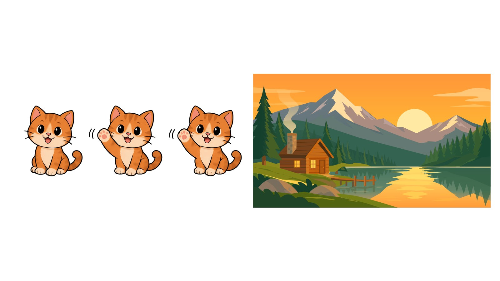

# GPT Image 2.6 的 GIF 和 SVG 功能带来的 40 个赚钱机会

[English](README.md) | 中文



OpenAI 在 2026 年 11 月发布的 GPT Image 2.6 能直接输出 GIF 动图(2–16 帧)和 SVG 矢量图。这份清单按六类整理了用这两个功能可能赚到钱的 40 个方向,每个方向写四件事:怎么做、在哪卖、价格参考、必须遵守的规则。生成参数、后处理步骤和提示词模板统一放在文末。

**整理方:**[apimodels.app](https://apimodels.app) 团队(我们提供 GPT Image 2.6 等多模型 API,一把 key 调用)。资料来自各平台公开规则和公开报道,数据截至 2026-11-07;平台规则会变,上架前请以平台最新说明为准。本文不构成收益承诺。

| # | 方向 | GIF 还是 SVG | 卖给谁 | 在哪卖 | 价格参考 |
|---|---|---|---|---|---|
| 1 | 微信赞赏表情 | GIF | 微信用户 | 微信表情开放平台 | 用户自定金额,目前全额到账 |
| 2 | 微信付费表情 | GIF | 微信用户 | 微信表情开放平台 | 10 微信豆一套 |
| 3 | 原创角色 IP | GIF + SVG | 授权方、周边买家 | 表情形象页、淘宝周边店 | 周边 10–200 元 |
| 4 | QQ 个性装扮 | GIF | QQ 用户 | 腾讯设计开放平台 | 按销量分成 |
| 5 | 红包封面·官方付费封面 | GIF 转 MP4 | 微信用户 | 红包封面开放平台 | 自定价,平台抽 20% |
| 6 | 红包封面代设计 | GIF + 静图 | 企业、公众号 | 私单 | 发放费 1 元一个,由委托方付 |
| 7 | LINE 动态贴图 | GIF 转 APNG | LINE 用户 | LINE Creators Market | 240–600 日元档 |
| 8 | Telegram 贴纸包 | GIF 转 WEBM | 社群、项目方 | Bot API | 定制 $15–65 |
| 9 | iMessage 贴纸 App | GIF 转 APNG | iPhone 用户 | App Store | 平台抽成 15% |
| 10 | WhatsApp 贴纸 App | GIF 转 WebP | WhatsApp 用户 | Google Play 等 | 头部 App 估算月收入 $1 万以上 |
| 11 | Kakao 表情 | 人工重绘 | KakaoTalk 用户 | Emoticon Studio | 2,500 韩元一套 |
| 12 | GIPHY / Klipy | GIF | 品牌委托方 | Creator Channel | 只给曝光,不按播放付费 |
| 13 | 国内个人定制 | GIF | 宠物主、情侣 | 闲鱼、小红书 | 9.9–99 元一套 |
| 14 | 企业品牌表情包 | GIF + SVG | 市场部、门店 | 设计公司、猪八戒 | 16 张动态 4,800–9,600 元 |
| 15 | 政府节庆表情包 | GIF | 政府、国企 | 公开采购 | 6.8 万元一单 |
| 16 | 海外个人定制 | GIF | 宠物主、博主 | Fiverr、Etsy、Instagram | 16 张 $90 |
| 17 | 社群与公司 emoji | GIF | 项目方、团队 | Fiverr、Gumroad | 每包 $25–50 |
| 18 | 主播 emote | GIF | Twitch 主播 | Fiverr | 起价 $15–41 |
| 19 | 贴纸生成站 | GIF | 普通用户 | 自建网站 | 每张 $2 |
| 20 | 透明 GIF 吉祥物 | GIF | 开发者 | 自建 SaaS | 每月 $15–119 |
| 21 | 可上机的 SVG 工具 | SVG | Cricut / 激光机用户 | 自建网站 | 每月 $7.99 |
| 22 | logo / 图标生成器 | SVG | 小商家 | 自建网站 | 一次性 $35–195 |
| 23 | Telegram / Discord 机器人 | GIF 转 WEBM | 聊天软件用户 | Bot + Stars | 每 Star 约 $0.013 |
| 24 | 出海 App | GIF + SVG | 海外用户 | 应用商店 | 平台抽成 15% |
| 25 | 国内小程序 / 网站 | GIF + SVG | 国内用户 | 企业主体小程序 | 9.9 元 10 次 |
| 26 | logo 代做 | SVG | 小微企业 | 猪八戒、Fiverr | 800–6,000 元 |
| 27 | 位图转矢量服务 | SVG | 手里只有位图 logo 的人 | Etsy、Dribbble | $5–24 |
| 28 | 激光 / 刻字 / 刺绣文件 | SVG | 设备用户 | Etsy、Creative Fabrica | $3.49–14.99 |
| 29 | Atomm 社区 | SVG | xTool 用户 | Atomm | 分成 80% |
| 30 | 素材站投稿 | SVG | 设计师 | Adobe Stock 等 | 分成 33% |
| 31 | 图标包自售 | SVG | Notion / Slack 用户 | Gumroad | 每包 $5–15 |
| 32 | 按需印刷 POD | SVG | T 恤买家 | Printify 等 | 每件版税约 $2.44 |
| 33 | Etsy 切割文件 | SVG | 手工卖家 | Etsy | 纸雕 $4.69–5.47 |
| 34 | 邮件 / 社媒 GIF | GIF | 营销团队 | Fiverr | $20 起 |
| 35 | 展示广告 GIF | GIF | 小商家 | Fiverr | $25 起 |
| 36 | 详情页动图与卖点图标 | GIF + SVG | 网店 | 私单 | 未找到报价 |
| 37 | 产品与游戏演示动图 | GIF | 开发者、游戏工作室 | Fiverr | $50–200 |
| 38 | 直播间素材 | GIF | 主播、商家 | 私单 | 未找到报价 |
| 39 | 内容账号 | GIF | 广告主 | 抖音、小红书 | 万粉账号一条 250–500 元 |
| 40 | 教程与素材包 | GIF + SVG | 想入门的新手 | 知识星球、Gumroad | 知识星球抽成 20% |

## 一、国内表情与装扮平台

### 1 微信赞赏表情
- 怎么做:每个表情带参考图单独出 6–8 帧 GIF,抠图后缩到 240×240,外缘加 2 px 白边,单张 ≤500 KB;一套 8–24 张 ([平台指南](https://sticker.weixin.qq.com/cgi-bin/mmemoticon-bin/readtemplate?t=guide/index))。
- 在哪卖:电脑端在 sticker.weixin.qq.com 上架,个人注册要大陆身份证和绑了银行卡的微信;视频号作者也可以用"微信表情助手"小程序从手机上架 ([光明网](https://m.gmw.cn/2026-04/14/content_1304417203.htm))。
- 价格:赞赏金额由用户自己定,目前全额进作者的微信零钱 ([平台指南](https://sticker.weixin.qq.com/cgi-bin/mmemoticon-bin/readtemplate?t=guide/index))。
- 规则:作品必须原创,不收二创和同人;上传时如果有 AI 声明选项,如实勾选 ([标识办法](https://www.cac.gov.cn/2025-03/14/c_1743654684782215.htm))。

### 2 微信付费表情
- 怎么做:制作方法和第 1 项相同。开通条件是已有一套作品上架、近三个月没有违规,然后在后台申请付费功能。
- 价格:统一每套 10 微信豆,收入按月结算 ([平台指南](https://sticker.weixin.qq.com/cgi-bin/mmemoticon-bin/readtemplate?t=guide/index))。
- 规则:付费表情是排他的,不能再投到其他平台,开通后也不能改回免费。

### 3 原创角色 IP
- 怎么做:固定一个原创角色,持续出新的表情套组,在微信建"表情形象"合集页;再用 SVG 做角色的矢量母版,供周边印刷使用。
- 在哪卖:形象授权、淘宝周边(售价 10–200 元)和商单 ([36氪](https://www.36kr.com/p/883703833707521))。
- 参考:蘑菇头主要靠 IP 授权赚钱,版权方曾就 7 张表情向一家公司索赔 49,479 元 ([澎湃新闻](https://www.thepaper.cn/newsDetail_forward_26087900))。
- 规则:留好人工创作的证据,并做作品登记;不写"××风格"。

### 4 QQ 个性装扮
- 怎么做:用 GIF 做动态挂件和聊天气泡,抠成透明的 PNG 序列帧。
- 在哪卖:在腾讯设计开放平台点"变现",进"美化平台"提交申请,审核通过后签约 ([腾讯设计开放平台](https://topd.tencent.com/realize)、[知乎](https://www.zhihu.com/question/422381694))。
- 规则:分成比例、尺寸规格和 AI 政策都没有公开,以签约时的说明为准。

### 5–6 红包封面:官方付费封面与代设计
- 怎么做:做 8 帧 × 200 ms 的小幅循环动画,转成 3:4、1–3 秒的 MP4 或 PNG 序列帧;挂件和气泡要抠成透明背景 ([腾讯云开发者社区](https://cloud.tencent.cn/developer/article/2488056))。
- 在哪卖:入驻要求公众号或视频号有 100 个关注;开通付费封面还要求近一年内至少发放过 1 款封面 ([腾讯新闻](https://news.qq.com/rain/a/20240810A00DPY00)、[站长之家](https://www.chinaz.com/feed/0125/1666228.shtml))。
- 价格:付费封面自己定价,单个封面收入满 50 热度值时平台抽 20%,不满时每单收 1 元;代设计的话,由委托方按 1 元一个支付发放费 ([站长之家](https://www.chinaz.com/feed/0125/1666228.shtml)、[歸藏](https://news.qq.com/rain/a/20250108A0807J00))。
- 规则:封面和序列号都不能售卖或转让,违规会被收回并下架 ([微信客服](https://support.weixin.qq.com/cgi-bin/mmsupportacctnodeweb-bin/pages/Z7N8dcm17bQgRN33));2027 年春节约在 2 月 6 日,首款封面要在 12 月前发放。

## 二、海外贴纸与表情平台

### 7 LINE
- 怎么做:选 6–8 个不同的帧,转成透明 APNG,尺寸不超过 320×270,时长 ≤4 秒,文件 ≤1 MB ([LINE 指南](https://creator.line.me/en/guideline/animationsticker/))。
- 在哪卖:通过网页版 Creators Market 上架;收款只支持 PayPal Premier 或 Business 账户,满 1,000 日元才能提现;大陆居民要先确认自己的 PayPal 商家账户能用 ([LINE 帮助](https://help2.line.me/creators/web/categoryId/20002319/3/pc?lang=en))。
- 价格:作者分成 = (售价 − 平台费)× 50%;动态贴图的价格档是 240–600 日元;订阅版 Premium 按"订阅人数 × 12 日元 × 发送占比"给作者分钱 ([LINE 帮助](https://help2.line.me/creators/web/categoryId/20002319/3/pc?lang=en)、[LINE 2016](https://linepluscorp.com/pr/news/en/2016/1391))。
- 规则:提交时要设置 "Use of AI",标题和说明里不能写 "XXXX-style" ([LINE 帮助](https://help2.line.me/creators/ios/pc?contentId=20005099&lang=en))。

### 8 Telegram
- 怎么做:转成 WEBM VP9 格式,一边正好 512 px,时长 ≤3 秒,文件 ≤256 KB ([Telegram](https://core.telegram.org/stickers));可以用 sticker-convert 直接上传 ([GitHub](https://github.com/laggykiller/sticker-convert))。
- 在哪卖:官方不能给贴纸包标价,钱从定制服务(第 16–17 项)或 Stars 收费机器人(第 23 项)里收。

### 9 iMessage
- 怎么做:做成 408×408 的 APNG,每张 ≤500 KB,同一个贴纸包里不能混用不同尺寸 ([Apple HIG](https://developer.apple.com/design/human-interface-guidelines/imessage-apps-and-stickers))。
- 在哪卖:在 App Store 上架,开发者账号年费 $99;加入小企业计划后平台抽成 15% ([Apple](https://developer.apple.com/app-store/small-business-program/))。

### 10 WhatsApp
- 怎么做:做成 512×512 的动态 WebP,每张 ≤500 KB,第一帧必须是完整画面,每包 3–30 张 ([WhatsApp](https://github.com/WhatsApp/stickers/blob/main/Android/README.md))。
- 在哪卖:WhatsApp 本身不卖贴纸,要做第三方贴纸 App,靠广告和内购赚钱;第三方估算,头部的贴纸制作工具 App 月收入在 $1 万到 $5 万以上 ([AppGoblin](https://appgoblin.info/apps/stickerwhatsapp.com.stickers/trends))。
- 规则:App 里如果有 AI 生成功能,必须提供举报入口 ([Google Play](https://android-developers.googleblog.com/2024/06/enabling-safe-ai-experiences.html?hl=en))。

### 11 Kakao
- 怎么做:AI 只用来做策划和台词,最终画面要人工重绘;动态表情 360×360,GIF 不超过 24 帧 ([ice-ice-bear](https://ice-ice-bear.github.io/posts/2026-04-22-chatgpt-kakao-emoji-viability/)、[Soomgo](https://soomgo.com/a.%EC%B6%A9%EB%B6%81-%EA%B4%B4%EC%82%B0%EA%B5%B0/%EC%BA%90%EB%A6%AD%ED%84%B0-%EC%9D%B4%EB%AA%A8%ED%8B%B0%EC%BD%98-%EC%A0%9C%EC%9E%91))。
- 价格:一套 2,500 韩元,作者分到约 35–40%(二手资料)。
- 规则:Kakao 限制生成式 AI 表情入驻 ([SBS Biz](https://biz.sbs.co.kr/amp/article/20000135095));外国作者能否注册、如何注册没有公开说明。

### 12 GIPHY / Klipy
- 怎么做:用原创角色做反应 GIF,上传满 5 个后申请 Creator Channel,在主页简介里挂 LINE 或 Fiverr 的链接 ([GIPHY](https://support.giphy.com/hc/en-us/articles/4631422637082-Apply-for-a-Creator-Channel))。
- 在哪卖:两个平台都不按播放量付钱。Tenor API 在 2026-06-30 关停后,WhatsApp 的 GIF 搜索改用 GIPHY ([9to5Google](https://9to5google.com/2026/06/30/google-tenor-api-gif-updates/));想和 Klipy 合作,通过 GRIN 平台提交提案 ([GRIN](https://app.grin.ai/brands/klipy.com))。

## 三、定制服务

### 13 国内个人定制
- 怎么做:让客户提供 3–5 张正脸照,先出一张角色定稿图让客户确认,再逐张出 GIF;交付分"存进微信收藏用"和"上架用"两档。
- 在哪接单:闲鱼、小红书;小红书禁止把客户引到站外交易,成交要走小红书商城 ([腾讯新闻](https://news.qq.com/rain/a/20250312A05A1Y00))。
- 价格:一套 9.9–99 元 ([知乎](https://zhuanlan.zhihu.com/p/2047334032057414870));作为对照,手绘一个 200–300 元 ([蓝橙视觉](http://www.cdwjyx.cn/23news/14378.html))。
- 规则:只接客户本人或家人的照片,并留书面同意;不接名人和已有 IP;定制商品不适用七天无理由退货,但必须显著标注 ([澎湃](https://www.thepaper.cn/newsDetail_forward_32772328))。

### 14–15 企业、品牌、门店与政府表情包
- 怎么做:客户已有吉祥物的,拿它当参考图批量出 16 张动态表情;没有吉祥物的,先设计 IP 形象并做 SVG 母版。
- 在哪接单:设计公司、猪八戒、企业私域;可以帮客户上架成免费的推广类表情,这类表情不进表情商店,但能被搜索到 ([平台指南](https://sticker.weixin.qq.com/cgi-bin/mmemoticon-bin/readtemplate?t=guide/index))。
- 价格:16 张动态 4,800–9,600 元 ([蓝橙视觉](http://www.cdwjyx.cn/23news/14378.html),2023);吉祥物加表情包 7,000–10,000 元 ([猪八戒](https://www.zbj.com/fuwu/dtbqsj/));徐圩新区的新春表情包成交价 6.8 万元 ([徐圩新区](http://ggzy.xwxq.gov.cn/home/tradeDetail?type=1&pid=3545&nid=4892),2024)。
- 规则:要签合同、开发票、写版权转让条款;政府项目要以企业主体投标,或给中标方做分包。

### 16 海外个人定制
- 怎么做:同一套角色按平台出多个版本交付:WebP(WhatsApp)、WEBM(Telegram)、APNG(iMessage)和透明 PNG。
- 在哪接单:Fiverr、Etsy、Instagram 私信。
- 价格:Fiverr 上一个贴纸包 $25–65 ([Fiverr](https://www.fiverr.com/nomueraspolilla/design-a-telegram-sticker-pack-for-you));Etsy 宠物数字肖像 $32.50 ([Etsy](https://etsy.com/listing/1274715432/cartoon-pet-portrait-custom-pet-portrait));Instagram 接单 8 张 $50、16 张 $90、24 张 $120 ([新浪财经](https://finance.sina.com.cn/jjxw/2026-04-17/doc-inhuuyih0984239.shtml))。
- 规则:Fiverr 上客户问起时必须说明用了 AI,客户要求不用 AI 时必须照做 ([Fiverr Help](https://help.fiverr.com/hc/en-us/articles/37333301560593-Using-AI-on-Fiverr-Guidelines-for-freelancers-and-clients));Etsy 要在商品描述里写明用了 AI。

### 17 社群与公司 emoji
- 价格:给加密项目做 Telegram 贴纸包 $25–50,这个服务有 597 条评价 ([Fiverr](https://www.fiverr.com/myselfrobiul/create-telegram-stickers-pack-for-your-crypto-project));emoji 包每包 10–20 个,卖 $5–15 ([MakeEmoji](https://makeemoji.com/blog/monetizing-custom-emojis-pricing-guide))。
- 怎么做:Slack emoji 128×128、约 128 KB;Discord emoji ≤256 KB ([CommunityOne](https://blog.communityone.io/discord-gif-emoji-size/))。

### 18 主播 emote
- 怎么做:拿主播的头像或立绘当参考图,出 6–8 帧动画,导出 112、56、28 px 三档尺寸,画面每秒闪烁不超过 3 次 ([Pixotter](https://pixotter.pages.dev/blog/twitch-emote-size/))。
- 在哪接单:Fiverr 上同类服务有 1,900 多个,起价 $15–41 ([Fiverr](https://www.fiverr.com/search/gigs?query=animated%20twitch%20emotes))。
- 价格:人工画师 1 个 $25、3 个 $65 ([laziyu](https://laziyu-emotes.carrd.co/))。
- 规则:VGen 和 Skeb 不收 AI 作品 ([VGen](https://help.vgen.co/hc/en-us/articles/12882944163991)、[ANN](https://www.animenewsnetwork.com/interest/2022-12-27/japanese-art-commission-platform-skeb-bans-ai-art/.193383));AI 做的单放在 Fiverr 或自己的页面上,注明 "AI-assisted, hand-finished"。

## 四、开发者产品

### 19 贴纸生成站
- 怎么做:流程是参考图生成、逐帧抠图、按平台转码打包;免费额度只给带水印的预览图。
- 价格:Deskslap 每张 $2,含 3 次重试 ([TrustMRR](https://trustmrr.com/startup/deskslap));Artificial Studio 1,000 积分卖 $12 ([Artificial Studio](https://www.artificialstudio.ai/create/face-to-sticker))。
- 规则:要拦截已有 IP 的关键词,并提供举报入口。

### 20 透明 GIF 吉祥物
- 怎么做:锁定吉祥物形象,出小动作循环;用在网页上时交付 APNG 或 WebP。
- 价格:mascofast 每月 $15、$39、$119 三档 ([Columbus](https://columbus.tools));gififyai 一次性 $19.99 ([gififyai](https://gififyai.com/pricing))。

### 21 可上机的 SVG 工具
- 怎么做:2.6 生成 SVG 时不接受参考图,所以"位图转矢量"要另接描图引擎;输出要清洗成闭合、分层的路径。
- 价格:VectoSolve 每月 $7.99 或每年 $49,经 Stripe 验证近 30 天收入 $3,110 ([TrustMRR](https://trustmrr.com/startup/vectosolve));SVG Bloom 100 积分 $9.99 ([G2](https://ai.g2.com/marketplace/tools/svg-bloom))。

### 22 logo / 图标生成器
- 怎么做:logo 用横排的短字标,控制在 3–4 种颜色;一整套图标用 3×2 网格一次生成 ([Lightlyn](https://image.lightlyn.com/gpt-image-2-6))。
- 价格:Brandmark 一次性 $35、$95、$195 三档 ([Brandmark](https://brandmark.io/pricing/));Looka 一次性 $35 或 $72 ([PricingSaaS](https://pricingsaas.com/companies/looka/diffs/2026W38))。
- 规则:提醒用户自己做商标检索 ([Foley](https://www.foley.com/news/2025/06/foley-attorneys-explore-ip-considerations-for-ai-generated-logos))。

### 23 Telegram / Discord 机器人
- 怎么做:用户上传照片,机器人生成 8–16 个动态贴纸,转成 WEBM 后用 Bot API 建好贴纸包。
- 收款:必须用 Telegram Stars 收款,开发者每颗 Star 约得 $0.013,最长 21 天后经 Fragment 以 TON 提现 ([Telegram](https://telegram.org/tos/bot-developers));大陆个人要先确认加密货币出金是否合规。
- 价格:一个订阅制机器人每月收 150 Stars 或 750 Stars ([dev.to](https://dev.to/__747bb5a1521/i-built-a-paid-telegram-bot-heres-what-telegram-stars-actually-pay-3fo))。

### 24 出海 App
- 怎么做:贴纸格式要求见第 9、10 项;Google Play 要求生成式 AI App 内置举报入口 ([Android Developers](https://android-developers.googleblog.com/2024/06/enabling-safe-ai-experiences.html?hl=en))。
- 规则:OpenAI API 不支持中国大陆、香港和澳门,App 只在支持的地区上架 ([OpenAI](https://developers.openai.com/api/docs/supported-countries))。

### 25 国内小程序 / 网站
- 条件:个人主体的小程序开不了深度合成类目,要用企业主体 ([微信文档](https://developers.weixin.qq.com/minigame/dev/wxcloud/guide/extensions/extend/ai.md));算法备案的主体必须和签约主体一致 ([CSDN](https://adg.csdn.net/6a699332662f9a54cb95a377.html));用户下载导出的图片要加 AI 标识 ([新华网](https://www.news.cn/tech/20250319/a572ec4366f149c1b0b04a07ebf4931b/c.html))。
- 走法:国内版接入已经备案的国产模型;GPT Image 2.6 版本做成出海产品。
- 价格:一个 AI 红包封面生成站收 9.9 元 10 次 ([hongbao.elvinn.wiki](https://hongbao.elvinn.wiki/pricing))。

## 五、SVG 相关

### 26 logo 代做
- 怎么做:先出 10–20 个 SVG 方向稿(生成费约 $0.63),人工修改后交付 SVG、AI、PDF、PNG 全套文件。
- 价格:猪八戒参考价 800–6,000 元 ([猪八戒](https://tf.zbj.com/sem/pc/yxlogo?pmcode=128273572));Fiverr 常见价位 $30–50 ([WebsiteBuilderInsider](https://www.websitebuilderinsider.com/how-much-does-a-logo-cost-on-fiverr/))。
- 规则:交付前做商标检索,合同写明版权转让范围 ([U.S. Copyright Office](https://www.copyright.gov/newsnet/2025/1060.html))。

### 27 位图转矢量服务
- 怎么做:简单的 logo 按文字描述让 2.6 重画成 SVG,复杂的图用描图工具。
- 价格:Etsy 上"AI logo 转矢量"$15–24.39,照片转 SVG $5 ([Etsy](https://www.etsy.com/search?q=ai+generated+svg+cricut));Dribbble 上 $59 起 ([Dribbble](https://dribbble.com/services/83603-Convert-to-Vector-Image-Tracing-Service))。

### 28 激光 / 刻字 / 刺绣文件
- 怎么做:出徽章、剪影这类雕刻图案,切割线做成闭合的单线路径;刺绣要另外转成 PES 或 DST 格式 ([Creative Fabrica](https://help.creativefabrica.com/hc/en-us/articles/25796577543196-What-are-the-guidelines-for-products-on-Creative-Fabrica))。
- 在哪卖:Etsy、Creative Fabrica、Glowforge Catalog;Glowforge 的 Premium 会员可以免费成为 Catalog 设计师,平台不抽佣 ([Glowforge](https://support.glowforge.com/hc/en-us/articles/1260804788069-glowforge-catalog-designer-faq))。
- 价格:Etsy 上激光套件卖 $3.49–14.99 ([Etsy](https://www.etsy.com/search?q=svg+cut+file))。

### 29 Atomm 社区
- 价格:付费项目作者分 80%,材料佣金最高 30%,攒满 $20 可以提现;平台称头部创作者月入 $3,000 以上 ([Atomm](https://www.atomm.com/creatorprogram))。
- 怎么做:在 xTool 激光机上实测过后,连同材料和参数一起发布成品项目。

### 30 素材站投稿
- 在哪投:Adobe Stock(分成 33%,每次授权 $0.33–0.99)([Adobe](https://helpx.adobe.com/stock/contributor/help/royalty-details.html));Creative Fabrica 的 AI 分类;IconScout(分成 40–70%)([LottieFiles](https://lottiefiles.notion.site/Contributors-Royalty-Distribution-Method-355510be417c4f0e810a208c3bbde10f));摄图网(分成最高 50%)([摄图网](https://content.699pic.com/))。
- 规则:Adobe 要勾选 AI 标记,同一个提示词不能投多个版本 ([Adobe](https://helpx.adobe.com/stock/contributor/submit-your-content/submit-generative-ai-content/generative-ai-content-guidelines.html));千库网过审的作品版权归平台;站酷海洛只收美图 WHEE 和 Midjourney 生成的图 ([站酷海洛](https://www.hellorf.com/subject/aigc-activity));Envato 和 Shutterstock 不收 AI 作品 ([Envato](https://help.author.envato.com/hc/en-us/articles/13313674070681-AI-generated-content-policy-for-Market-and-Elements))。

### 31 图标包自售
- 怎么做:用网格提示词一次出整套图标,再用 svgo 清洗,颜色改成 currentColor 方便换色。
- 价格:Notion 图标包 $2–12 ([Gumroad](https://vipgraphics.gumroad.com/l/notionicon));emoji 包每包 $5–15。

### 32 按需印刷 POD
- 怎么做:扁平图案直接上传 SVG,Printify 会用 Smart Scaling 自动缩放;上传前删掉文件里的 CSS ([Printify](https://printify.com/guide/design-guide/export-and-file-formats/)、[Spreadshop](https://spreadshop.com/helpcenter/design-products-printing/what-are-the-print-file-requirements))。
- 价格:亚马逊 Merch on Demand 上 $19.99 的 T 恤,作者版税约 $2.44 ([MerchTitans](https://merchtitans.com/tools/amazon-merch-royalty-calculator));TeePublic 每件约 $4 ([TopBubbleIndex](https://www.topbubbleindex.com/blog/teepublic-ai-art/))。
- 规则:Zazzle 要求 AI 作品打 generativecontent 标签 ([Zazzle 社区](https://community.zazzle.com/t5/ask-a-question/question-for-mods-about-ai-tagging-policy/m-p/75586));避开别人的商标。

### 33 Etsy 切割文件
- 怎么做:清洗后导出 SVG、PNG、DXF、EPS、PDF 五种格式,再用文件真的切一件成品拍照。
- 价格:分层纸雕 $4.69–5.47,激光套件最高 $14.99,商用授权单卖 $78 ([Etsy](https://www.etsy.com/search?q=svg+cut+file)、[CitraGraphics](https://www.etsy.com/shop/CitraGraphics))。
- 规则:商品描述里要写明用了 AI;2026-10-22 起每个商品至少要有一张未修改的实物照片,禁止机器人批量上架 ([PPC Land](https://ppc.land/etsy-forces-sellers-to-show-one-unaltered-photo-in-every-listing/))。

## 六、GIF 营销与内容

### 34 邮件 / 社媒 GIF
- 怎么做:用 2–6 帧扁平插画,第一帧要能单独当海报看;宽约 600 px,文件 <1 MB,颜色控制在 64–128 色 ([Litmus](https://www.litmus.com/blog/animated-gifs-in-email-10-tips-for-keeping-files-sizes-small))。
- 价格:Fiverr 入门价 $20,同类目常见 $60–70,定制款 $150 起 ([Fiverr](https://www.fiverr.com/categories/video-animation/buy/animated-gifs/emails-newsletters))。

### 35 展示广告 GIF
- 怎么做:每帧至少 210 ms(低于 5 FPS),文件 ≤150 KB,裁成 300×250 等标准广告尺寸 ([Google Ads](https://support.google.com/google-ads/answer/1722096?hl=en))。
- 价格:Fiverr 上 GIF 广告 $25 起 ([Fiverr](https://www.fiverr.com/gigs/gif-ads))。

### 36 详情页动图与卖点图标
- 怎么做:淘宝主图只能放静态图,GIF 放在详情页里,宽约 750 px、每张 ≤3 MB ([晓多](https://insight.xiaoduoai.com/e-commerce-information/taobao-information/can-taobao-product-details-page-display-animated-images-what-are-the-requirements-for-the-product-details-page-full-guide-to-animated-images-on-taobao-details-page-3-seconds-to-quickly-increase-conver.html));商品本身用实拍图,AI 动图只做氛围图和卖点图标。
- 规则:AI 生成的图用作商品宣传时,必须显著标识 ([央广网](https://www.cnr.cn/mspd/zhsh/20260116/t20260116_527494911.shtml))。

### 37 产品与游戏演示动图
- 怎么做:Product Hunt 缩略图可以用 GIF,文件 <3 MB,第一帧要能当静态图 ([Product Hunt](https://help.producthunt.com/posting/how-to-post-a-product));也可以做 README 和 Steam 商店页的演示动图。
- 价格:Lottie 动画或加载动画 $50–200 ([Fiverr](https://www.fiverr.com/shyrimar/create-clean-lottie-animation-for-web-and-mobile-apps))。

### 38 直播间素材
- 怎么做:做 9:16 透明背景的氛围循环(飘落、光效),文字贴片由人工排版 ([Canva](https://www.canva.cn/learn/live-commerce-premovie-adverts/))。

### 39 内容账号
- 怎么做:固定一个原创角色,持续出表情和节日封面;推广时用视频演示,再引导"微信搜表情名",不要直接发 GIF 原图 ([微信指南](https://sticker.weixin.qq.com/cgi-bin/mmemoticon-bin/readtemplate?t=guide%2Freal))。
- 价格:约 2021 年的数据,万粉的表情包号接一条广告约 250–500 元 ([知乎](https://zhuanlan.zhihu.com/p/382096913))。
- 规则:主动标注 AI 内容,小红书对未标注的 AI 内容限流 ([澎湃](https://www.thepaper.cn/newsDetail_forward_32599956))。

### 40 教程与素材包
- 在哪卖:知识星球(个人星球平台抽 20%)([搜狐](https://news.sohu.com/a/671562738_100126234))、小红书商城、Gumroad。
- 规则:Etsy 不允许卖 AI 提示词合集 ([Etsy](https://www.etsy.com/legal/creativity));不教怎么去掉 AI 标识 ([澎湃](https://www.thepaper.cn/newsDetail_forward_32599956))。

## 共用生产流程

- 参数(apimodels.app 2026-11-07 实测):frame_count 取 2–16,超过 16 会返回 400,网上"2–64 帧"的说法已经过时;4–16 帧、每帧 512–960 px 的组合 10–24 秒出图;4 帧 512×512 low 一次约 $0.015;GIF 不保证透明背景;传入参考图能保持角色一致,带参考图做 GIF 编辑可以正常使用;SVG 只支持文生图、每次 1 张,画布最大约 1K,画质参数对 SVG 不起作用,每张 $0.0315。
- 帧数:贴纸用 6–8 帧最清楚;12–16 帧动作更流畅,但每帧只有约 720 px。
- 后处理:拆帧 → 用纯色抠像或 rembg 去背景 → 所有帧按同一个框裁切 → 缩放。导出 GIF 时把透明度二值化,再加 2 px 白边;导出 APNG、WebP、WEBM 时保留 8 位透明。最后按平台规格封装和压缩,可以用 sticker-convert 批量处理 ([sticker-convert](https://github.com/laggykiller/sticker-convert))。
- SVG 清洗:去掉背景矩形,颜色改成 currentColor,用 svgo 优化;切割文件要把路径闭合并分层 ([allsvgicons](https://allsvgicons.com/blog/fixing-ai-generated-svgs-cleaning-paths/))。
- 合规:留存提示词和原始文件,按各平台的要求申报 AI。

```text
[角色锚点:外形、配色、服饰,每次逐字复用] Keep the exact character from the reference image. Do not redesign the character.
The character [一个小动作], then returns to its starting pose. Fixed camera, same framing in every frame, everything else stays still.
Flat illustration on a plain solid [#FF00FF] background. No text. Seamless loop.
参数:output_format=gif,frame_count=6–8,frame_duration_ms=100–150,附参考图
```

## 关于本仓库

- 内容采用 [CC BY 4.0](LICENSE) 协议,转载请注明出处。
- 发现规则过时、价格变化或想补充新方向,欢迎提 Issue 或 PR。
- 想直接调用 GPT Image 2.6 的 GIF 和 SVG:[apimodels.app/models/gpt-image-2.6-flare](https://apimodels.app/models/gpt-image-2.6-flare),文档见 [apimodels.app/docs/gpt-image-2-6](https://apimodels.app/docs/gpt-image-2-6)。
- 每个 GIF、每张 SVG 的实测花费,共用的生产流程,以及开发者能在这份清单上直接做的几类产品,写在我们的博客里:[GPT Image 2.6 的 GIF 和 SVG 功能带来的 40 个赚钱机会](https://apimodels.app/zh/blog/gpt-image-2-6-gif-svg-money-ideas)。
